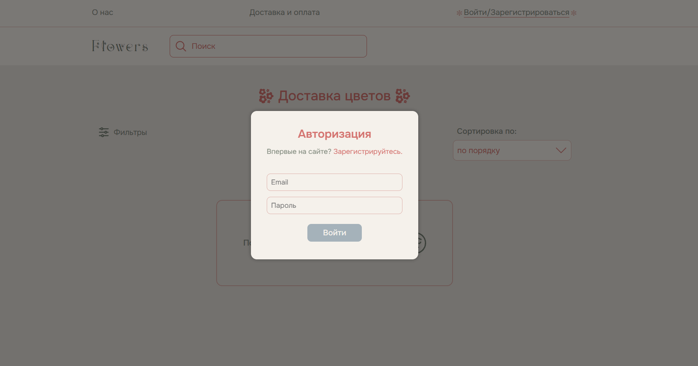
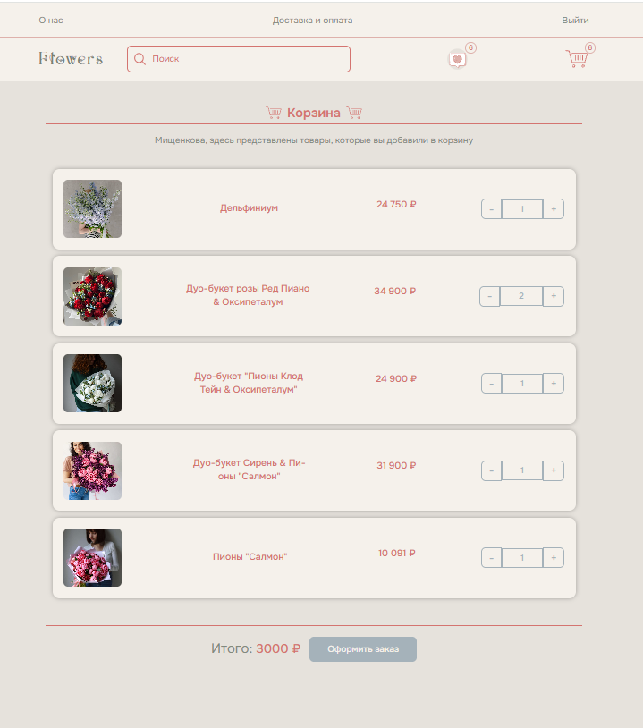
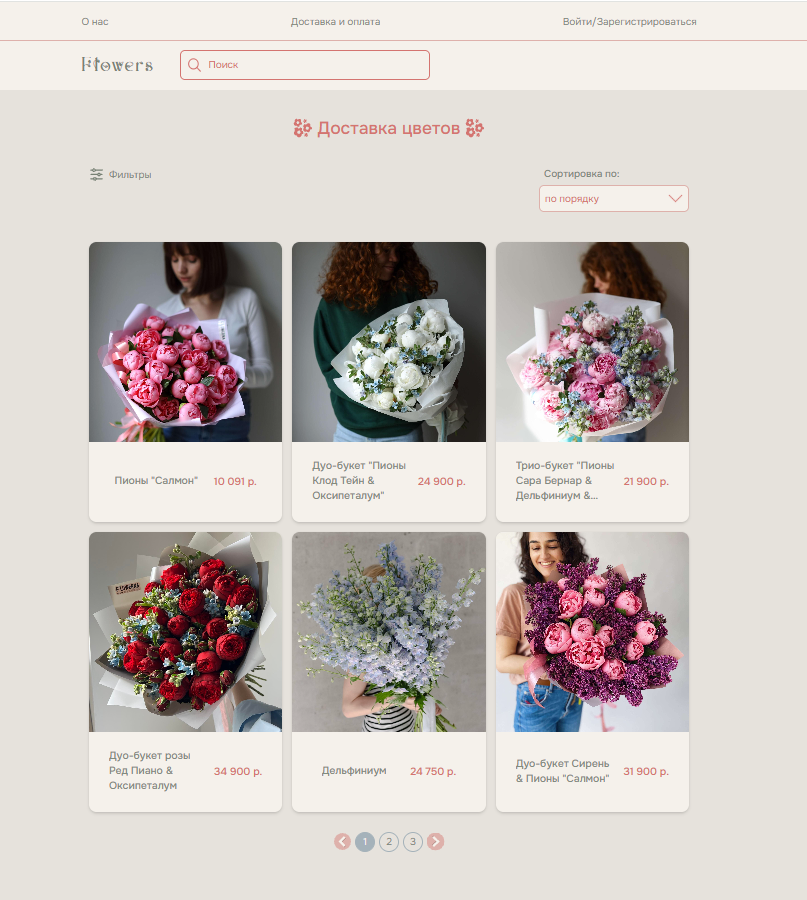
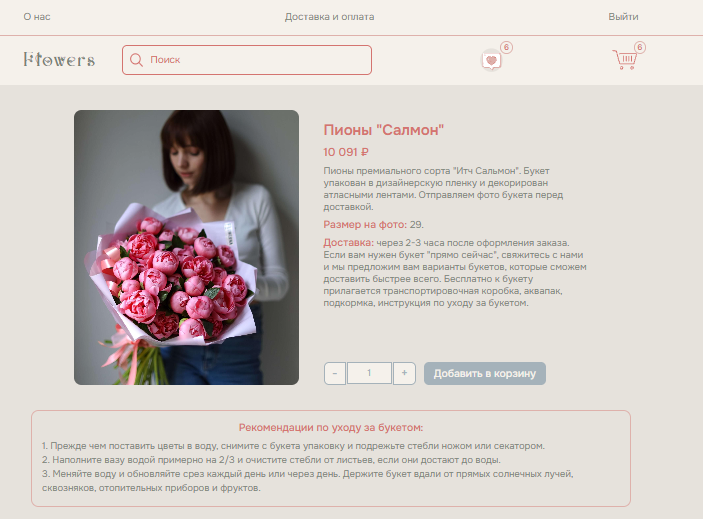

# Flower Shop

Интернет-магазин цветов: каталог с поиском, фильтрами и сортировкой, корзина, избранное и авторизация. Товары и пользователи хранятся в headless CMS Strapi, каталогом можно управлять через её админ-панель.






## Стек

- **Фронтенд:** Vue 3, Vuex, Vue Router, Axios, SCSS, Vite, ESLint, Stylelint
- **Бэкенд:** Strapi (REST API, JWT-авторизация, админ-панель)

## Возможности

- Каталог товаров с пагинацией
- Поиск по названию, фильтры (в модальном окне на мобильных) и сортировка по цене
- Детальная страница товара
- Корзина с изменением количества и подсчётом суммы
- Избранное
- Регистрация и вход через Strapi
- Страницы «О нас» и «Доставка и оплата»
- Адаптивная вёрстка

## Структура

```
my-strapi-project/   — бэкенд на Strapi (типы контента: каталог цветов, категории)
new-project-vue/     — фронтенд на Vue 3
```

## Запуск

**1. Бэкенд**

```bash
cd my-strapi-project
cp .env.example .env
npm install
npm run develop
```

Админ-панель Strapi откроется на http://localhost:1337/admin

**2. Фронтенд**

```bash
cd new-project-vue
npm install
npm run dev
```
